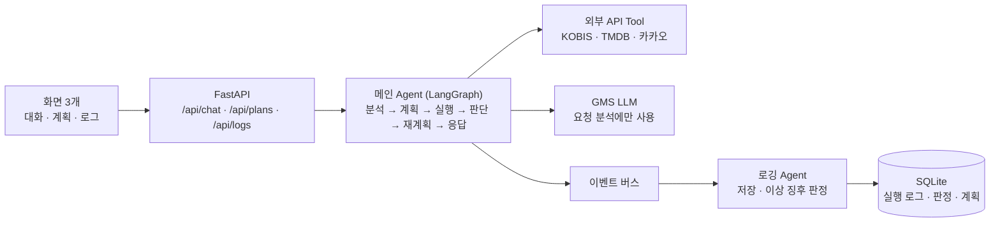

# 멀티 모델 오케스트레이션으로 만든 Agent 영화 플래너

"토요일 3시 이후 강남에서 영화 보고 7시 전에 끝내고 싶어" 같은 요청을 받아 실제 박스오피스·영화 정보·영화관 데이터를 조회하고, 시간 제약에 맞는 영화를 계산해 추천하는 LangGraph Agent 서비스입니다.

이 저장소에서 더 중요한 것은 **어떻게 만들었는가**입니다. 직접 설계한 Claude Code 스킬로 역할을 나눈 여러 AI 모델이 구현·검토·에스컬레이션을 맡았고, 사람(저)은 파이프라인 설계와 의사결정, 승인을 맡았습니다.

> SSAFY AI 코어 프로젝트 3회차 과제로 만든 개인 프로젝트입니다. 과정 명세서 원문은 포함하지 않으며, 요구사항은 구현 기준으로 다시 썼습니다.

## 한눈에 보기

| | |
|---|---|
| 서비스 | FastAPI + LangGraph Agent + 바닐라 JS 화면 3개(대화·계획 관리·실행 로그) |
| 외부 연동 | KOBIS 오픈 API(박스오피스·영화 상세), TMDB(현재 상영작), 카카오 로컬(영화관), SSAFY GMS LLM |
| 만든 방식 | 오케스트레이터 Claude Opus → 일꾼 GPT-6.2-Sol → 독립 검토자 Claude Opus xhigh → 막히면 GPT-6.2-Astra |
| 검증 | 단위 테스트 121개 통과, 합성 대표 시나리오 6/6, 실제 API 이벤트 샘플 6건, 브라우저 확인 |
| 과정 기록 | 일꾼 32회, 독립 검토 17회 완료, Astra 1회, 결정 기록 28건(D01~D44) |

## 구조



- LLM은 **요청 분석에만** 씁니다. 계산(러닝타임 + 광고 10분으로 "늦어도 몇 시에 시작" 역산), 제약 판단, 재계획(최대 3회), 응답 문장은 모두 코드 규칙입니다.
- 명시된 시각·날짜는 LLM 대신 규칙으로 뽑습니다. 실제 모델이 "4시 35분 전"을 19:25로 읽은 일이 있었기 때문입니다. 규칙이 모호하면 물러나 LLM 값을 씁니다.
- KOBIS 이용약관(결과 저장 금지)에 맞춰, 실행 로그에는 호출과 판단의 **사실**만 저장하고 영화 정보는 화면에 실시간으로만 표시합니다.
- 로깅 Agent는 실행마다 반복 호출·과다 재계획·계획 밖 호출을 규칙으로 판정합니다. 이상일 때만 LLM이 원인을 진단합니다(심화 F3020).

## 저장소 구성

| 경로 | 내용 |
|---|---|
| [`app/`](app/) | 서비스 코드(백엔드·프론트·테스트·시나리오 스크립트)와 설계 문서 |
| [`app/docs/`](app/docs/) | 요구사항·Agent 설계·Tool 정의·API 명세·검증 결과·[결정 기록](app/docs/DECISIONS.md) |
| [`orchestration/`](orchestration/README.md) | 직접 만든 Claude Code 스킬 `astra-led-pipeline`과 운영 기록 |
| [`process/`](process/README.md) | 개발 과정 사례, 검토 기록, 실제 양식 예시 |

읽을 순서를 추천한다면 [과정 사례](process/case-studies.md) → [오케스트레이션](orchestration/README.md) → [Agent 설계](app/docs/Agent설계.md) 순입니다.

## 실행

Windows 기준입니다. 자세한 키 발급 절차는 [app/README.md](app/README.md)에 있습니다.

```powershell
cd app/backend
python -m venv .venv
.venv\Scripts\activate
pip install -r requirements.txt
copy .env.example .env   # KOBIS_API_KEY, KAKAO_REST_API_KEY, TMDB_API_KEY, GMS_KEY 입력
uvicorn app.main:app --reload
```

```powershell
cd app/frontend
python -m http.server 5500   # http://localhost:5500
```

키 없이도 확인할 수 있습니다.

```powershell
cd app/backend
python -m unittest discover -s tests -v          # 단위 테스트 121개
python scripts/run_scenarios.py --mode fixture   # 합성 데이터로 대표 시나리오 6개
```

## AI 활용에 대해

이 저장소의 코드는 대부분 AI 일꾼(GPT-6.2-Sol)이 작성했고, 검토도 AI(Claude Opus)가 했습니다. 제가 한 일은 다음과 같습니다.

- 역할·우선순위·호출 조건을 정한 오케스트레이션 스킬 설계
- 도메인과 범위 결정
- 되돌릴 수 없는 작업의 승인(API 키 발급, 데이터 삭제, 약관 동의)
- 결과 확인

작업 중 오케스트레이터와 일꾼이 만든 실수, 그리고 검증 구조가 그 실수를 잡아낸 과정도 숨기지 않고 [기록](process/case-studies.md#4-검증-구조가-오케스트레이터의-실수를-잡아낸-사례)했습니다.

## 출처

- 영화진흥위원회 영화관입장권통합전산망 · 통합전산망 오픈 API
- 카카오 로컬 API
- This product uses the TMDB API but is not endorsed or certified by TMDB.
