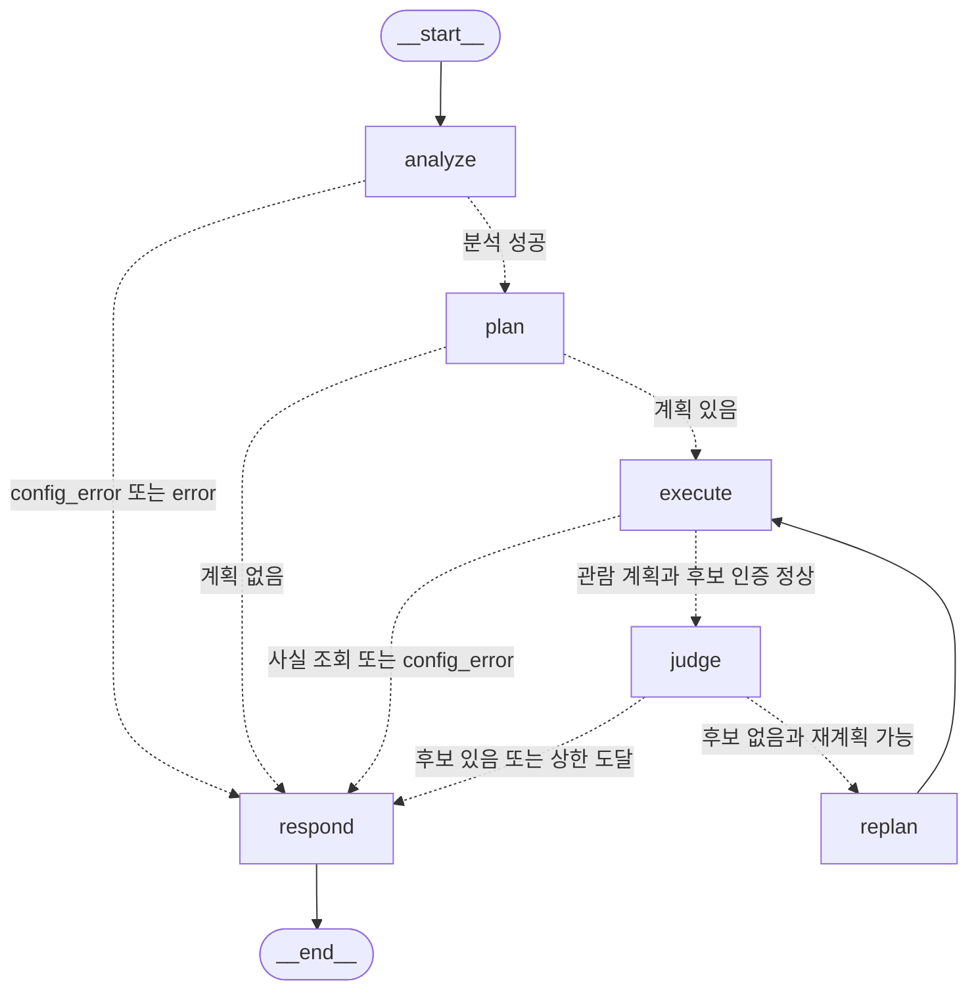

# Agent 설계

[graph.py](../backend/app/agent/graph.py)의 `run_agent(session_id, message, ...)`는 세션 ID, 메시지, KST 기준일을 초기 상태에 넣고 LangGraph를 실행합니다. `llm`, `tool_runner`, `event_bus`, `memory`, `today`, `detail_cache`는 호출자가 주입할 수 있습니다. 기본 구성은 SSAFY GMS, 등록 Tool, 공용 이벤트 버스, 프로세스 내 세션 Memory와 TMDB 상세 캐시를 사용합니다.

## 그래프

LangGraph의 여섯 노드는 요청을 분석하고, 필요한 조회를 실행하고, 결과를 판단해 응답을 만듭니다. 후보를 더 탐색할 때는 재계획에서 실행으로 돌아갑니다. 그래프는 `backend/`에서 `python scripts/print_graph.py`로 출력할 수 있습니다.



## 노드별 입력과 출력

노드는 [nodes.py](../backend/app/agent/nodes.py)에 있습니다.

| 노드 | 주요 입력 | 주요 출력과 다음 단계 |
| --- | --- | --- |
| `analyze` | `session_id`, `message`, `today`, 세션의 이전 조건 | `Analysis(intent, reason, conditions, fact_topic)`를 구조화해 받고 날짜·시간을 정규화합니다. 새 값과 기존 값을 병합해 `analysis`, `conditions`, `date_defaulted`와 `llm_decision` 이벤트를 만듭니다. GMS 키 누락은 `config_error`, 분석 실패는 `error`로 응답 단계에 보냅니다. |
| `plan` | `analysis`, `conditions` | `{step, tool, args, purpose}` 목록을 `plan`에 저장하고 최초 `pool_index=0`, `replan_count=0`으로 시작합니다. 일반 대화와 되묻기는 빈 계획으로 응답 단계에 보냅니다. |
| `execute` | `plan`, 후보 출처의 ID, 조회 이력과 상세 캐시 | 각 후보 목록을 읽어 `movie_cd` 또는 `tmdb_id`를 상세 조회에 넘깁니다. `candidates`, `seen_ids`, `seen_titles`, `details_cache`, `tool_results`, `failures`, `theaters`, `estimated_note`를 갱신합니다. |
| `judge` | `conditions`, 현재 `candidates`, `details_cache`, 광고 시간과 이전 판단 기록 | 제목·장르·러닝타임을 확인하고 `evaluations`, `feasible`, `excluded`, `title_matches`를 갱신합니다. 충족 후보가 있으면 `ok`, 풀 또는 상한을 소진했으면 `limit` 및 `limit_reason`을 설정하고 응답합니다. 그 사이에는 `next=replan`입니다. |
| `replan` | `conditions`, `pool_index`, `replan_count`, `details_cache` | 다음 풀의 조회와 상세 조회로 `plan`을 교체하고 두 카운터를 1씩 올립니다. `replan` 이벤트를 발행하고 `execute`로 이어집니다. |
| `respond` | 상태·추출 조건·추천·제외·Tool 근거·영화관 정보 | 코드 템플릿으로 `answer`와 `result`를 구성하고 조건이 있으면 세션 Memory를 갱신합니다. 추천은 순위순 최대 3개입니다. |

[state.py](../backend/app/agent/state.py)의 `AgentState`에는 위 필드와 실행 시작 입력 `session_id`, `message`, `today`, 최종 `status`, `answer`, `next`, `result`가 있습니다. `Conditions`는 `date`, `start_after`, `end_by`, `region`, `genre`, `movie_title`을 담습니다. `Analysis.intent`는 `plan_movie`, `fact_query`, `smalltalk`이며, 사실 조회의 `fact_topic`은 `boxoffice`, `runtime`, `theater`, `other`입니다.

`make_result()`의 반환 필드는 `status`, `answer`, `recommendations`, `excluded`, `theaters`, `criteria`, `evidence`, `replan_count`, `limit_reason`, `estimated_note`, `conditions`입니다. API가 추가하는 필드는 [API 명세서](API명세서.md)에 있습니다.

## 요청 분석과 날짜·시각 보정

D37과 D40에 따라 메시지에서 시작·종료 조건과 함께 나타난 한국어 시각을 정규식으로 추출합니다. `3시 이후`는 `start_after`에, `4시 35분 전에`는 `end_by`에 대응합니다. 아래 보류 조건에 해당하지 않는 1~11시는 `오전`, `아침`, `새벽`이 붙으면 오전으로, 그 외에는 영화 관람 맥락에 맞춰 오후로 해석합니다. [시각 규칙 코드](../backend/app/agent/analyzer.py)

날짜 규칙은 KST 기준일에서 오늘·내일·모레, 요일, 이번 주·다음 주 요일, `M월 D일`을 해석합니다. 주 수식어가 없는 요일은 오늘을 포함해 가장 가까운 해당 요일로 계산합니다. 이번 주·다음 주는 월요일을 기준으로 구분합니다. `M월 D일`이 올해 이미 지났으면 다음 해의 날짜를 사용합니다. 이번 주에서 이미 지난 요일이나 유효하지 않은 날짜는 규칙값을 반환하지 않습니다.

명확한 날짜·시각의 코드 규칙값을 우선 적용합니다. 날짜 표현이 여럿이거나 모호한 표현이 있으면 규칙을 보류하고 정규화한 LLM 값을 유지합니다. 시각도 밤·저녁 12시, 밤·새벽 1~5시, 또는 `N시 M분 전에`나 `N시 M분 전까지`에서 M이 20 이하이면 규칙을 보류합니다. 값이 실제로 바뀐 필드만 `llm_decision.payload.rule_overrides`에 `{llm, rule}` 형식으로 기록합니다. 지역·장르·영화 제목·의도는 LLM 분석을 사용합니다.

## 계획 수립과 재계획

- 관람 계획은 일별 박스오피스, 후보별 상세정보, 지역을 준 경우 영화관 위치 순으로 실행합니다. 영화 제목이 있으면 제목을 정규화해 부분 일치하는 후보의 상세를 조회합니다. 장르를 주면 상세정보에서 해당 장르를 확인한 후보만 시간 판단에 사용합니다.
- 사실 조회에서 순위 및 기타 주제는 일별 박스오피스, 러닝타임은 일별 박스오피스와 제목이 맞는 후보의 상세, 영화관은 카카오 검색을 실행합니다. 일반 대화의 Tool 계획은 비어 있습니다.
- 관람 요청에서 종료 제한만 있고 가능 시작 시각이 없거나 시작 가능 시각이 종료 제한과 같거나 늦으면 Tool 호출 전에 `clarify`로 응답합니다. 영화관 사실 조회에 지역이 없거나 러닝타임 사실 조회에 영화 제목이 없어도 되묻습니다.
- 관람 판단에서 충족 후보가 0개이고 남은 풀과 횟수가 있을 때만 재계획합니다. 풀의 순서는 (0) KOBIS 일별 박스오피스 → (1) KOBIS 주간 박스오피스 → (2) TMDB 국내 현재 상영작 1페이지 → (3) 2페이지입니다. 기본 `REPLAN_LIMIT`는 3이며, 네 풀을 소진하면 종료합니다. 이전 풀의 출처별 ID와 정규화 제목을 중복 제거에 사용하고, 요청 중 조회한 상세의 성공·실패 결과는 캐시에 둡니다. 영화관 검색은 첫 계획에서만 실행합니다.
- 후보 조회 `INVALID_KEY`는 설정 안내로 즉시 응답합니다. 카카오 검색 실패는 위치 정보만 빠지고 영화 판단을 계속합니다. 상세 실패는 해당 후보를 제외합니다. 충족 후보가 있거나, 사실 조회·일반 대화·되묻기·분석 오류인 경우 추가 풀을 탐색하지 않습니다. 상한에 이르면 제목을 확인하거나 시작·종료 시각, 장르를 조정할 수 있는지 묻습니다.

## Tool 실행과 응답

후보 목록을 받은 뒤 상세 ID를 출처별로 중복 제거하고 요청 내 `details_cache`를 먼저 확인합니다. TMDB 상세는 프로세스 메모리 서비스 캐시도 확인합니다. 서비스 캐시는 `tmdb:{tmdb_id}` 키로 정규화된 성공 상세를 TTL 6시간(21,600초) 동안 보관하며 대화 Memory와 별개입니다. KOBIS 상세는 현재 요청의 작업 메모리에서 재계획에 재사용하고 다음 요청에서는 다시 조회합니다. 실패한 상세는 현재 요청에서만 재사용합니다.

캐시에서 찾지 못한 상세 조회는 `ThreadPoolExecutor`에서 실행합니다. 공개 API에 동시에 보내는 요청 수를 줄이기 위해 동시 처리 상한을 `DETAIL_WORKERS=4`로 설정합니다. 상세 `tool_call`을 후보 순서로 먼저 발행하고, 작업 완료 시점과 관계없이 같은 순서로 결과를 회수해 `tool_result`를 발행하고 캐시를 갱신합니다. 각 결과의 `duration_ms`는 해당 조회의 실행 시간입니다.

캐시 적중은 `execute`의 `stage_end.payload`에 기록합니다. `cache_hits`에는 요청 내 캐시 적중, 같은 단계에서의 상세 요청 중복, 서비스 캐시 적중이 포함됩니다. `service_cache_hits`에는 그중 서비스 캐시 적중만 집계합니다. 상세의 `tool_call`·`tool_result`는 실제 Tool 호출에만 발행합니다.

`respond`는 누적된 Tool 실패를 코드별 사용자 안내로 바꿔 답변의 `조회 실패`에 표시합니다. 카카오 `NO_RESULT`는 입력 지역에서 영화관을 찾지 못했다는 안내이며, 시간 조건을 충족한 영화 추천은 유지합니다. 러닝타임 결측을 이미 표시한 제외 사유는 중복 안내를 피합니다. 실패 안내에는 키 값과 외부 API의 오류 원문을 싣지 않습니다.

## 시간 계산

[judge.py](../backend/app/agent/judge.py)의 `evaluate()`는 시간을 자정부터의 분으로 변환해 비교합니다. `AD_MINUTES` 기본값은 10입니다.

```text
필요 시간 = 러닝타임 + AD_MINUTES
충족 = 시작 가능 시각 + 필요 시간 ≤ 종료 제한 시각
최종 시작 가능 시각 = 종료 제한 시각 − 필요 시간
```

예를 들어 러닝타임 120분인 영화의 필요 시간은 130분이고, 15:00 시작 가정 시 17:10에 끝납니다. 19:00까지 끝나야 한다면 최종 시작 가능 시각은 16:50입니다. 시작·종료 값은 계산 기준입니다. 실제 상영 시각과 방문할 영화관은 사용자가 확인합니다. 러닝타임이 없으면 제외 사유를 남기고, 종료 제한이 없으면 확인된 러닝타임으로 필요 시간을 표시하며 `latest_start`는 `null`입니다.

## Memory

[memory.py](../backend/app/agent/memory.py)의 `SessionMemory`는 `session_id`별 직전 `Conditions`와 처리 상태를 프로세스 메모리에 저장합니다. 사용자가 새로 지정한 값을 병합하며 이전의 나머지 조건을 이어받습니다. 날짜를 지정한 적이 없으면 실행할 때 KST 오늘을 적용하고 Memory에는 `date=None`을 저장합니다. 처리 상태 필드는 `status`, `replan_count`, `recommendation_count`, `excluded_count`입니다. 프로세스를 재시작하면 Memory는 초기화됩니다.

KOBIS 결과 및 파생 계산값은 현재 요청의 그래프 상태와 실시간 응답(`answer`, `recommendations`, `excluded`, `evidence` 등)에서 사용합니다. 후속 요청의 GMS 분석에는 새 메시지·기준일·이전 조건을 전달하며, 대화 API는 그래프 상태의 외부 추적을 끕니다. SQLite에는 구조화 이벤트와 독립적으로 입력한 관람 계획을 저장합니다. 저장 폼과 API의 상세 필드는 [API 명세서](API명세서.md#관람-계획)에 있습니다.

## 이벤트와 로깅 Agent

`AgentNodes`와 `run_agent()` → [EventBus](../backend/app/events/bus.py) → [LoggingAgent](../backend/app/logging_agent/agent.py) → SQLite `run_logs` 순으로 전달됩니다. 메인 Agent는 발행 시 구독자가 누구인지 알지 못합니다. `EventBus`는 세션별 `seq`를 증가시키고 구독자별 복사본을 전달합니다. 구독 오류는 발행자와 다른 구독자의 동작을 막지 않습니다. 메인 Agent는 필드를 제한한 뒤 이벤트를 발행합니다. 로깅 Agent는 발행된 이벤트를 세션별로 그대로 SQLite에 추가하고 저장 실패를 내부 카운터에 기록합니다. `EventCollector`는 지정한 세션의 이벤트만 모으며, 대화 API나 시나리오 실행기가 현재 요청 범위에서 붙였다가 해제합니다.

공통 이벤트 필드는 `session_id`, `seq`, `ts`(KST ISO 시각), `type`, `stage`, `payload`, `duration_ms`(없으면 `null`)입니다.

| `type` | `payload`와 시간 |
| --- | --- |
| `stage_start` | 단계 진입, 빈 객체 |
| `stage_end` | 분석 의도, 계획, 후보·실패·캐시 수, 판단 결과 등 단계별 구조화 필드와 `duration_ms`. `respond`는 `status`와 `recommendation_count` |
| `tool_call` | `call_id`, `tool`, `provider`. 독립 입력은 `args`, 상세 조회는 `arg_names`(예: `["movie_cd"]`). 같은 실행에서 동일 Tool·입력이 반복되면 첫 호출의 ID를 `duplicate_of`에 추가 |
| `tool_result` | 동일한 `call_id`, `tool`, `provider`, `ok`, 정규화 오류 `code`(성공은 `null`), `duration_ms`. 실시간 `evidence`의 `summary`는 이벤트 필드에서 제외 |
| `llm_decision` | `intent`, `reason`, `extracted`, `merged`, `date_defaulted`. 날짜 규칙 적용 및 시각 보정 내역은 `rule_overrides`에 필드별 `{llm, rule}`로 추가하고, 같은 세션에 이전 판정이 있으면 `previous_run_verdict`를 추가 |
| `replan` | `replan_count`, `reason`, `next_pool`, `reused_details` |
| `error` | 예외 종류를 `kind`로 기록. 외부 API 오류 본문이나 호출 URL은 기록 대상에서 제외 |

병렬 상세도 요청과 결과가 같은 `call_id`로 연결됩니다. `get_movie_detail`의 제공자는 실제 호출 경로에서 결정합니다. 화면은 제공자·입력·성공/실패·시간으로 실행 과정을 표시합니다. KOBIS에서 얻은 제목·코드·순위·러닝타임 및 파생 계산값은 조회 결과로 취급해 영속 이벤트에서 제외합니다. [합성 대표 요청 전체 로그](logs_sample/fixture/01_first_pool.json), [실호출 이벤트 요약](logs_sample/live/summary.md)

로깅 분리 확인은 PowerShell에서 `$env:DISABLE_LOGGING_AGENT = '1'`을 설정한 뒤 `uvicorn app.main:app --reload`로 시작합니다. 새 `session_id`로 `POST /api/chat`을 보내면 응답의 `trace`는 수집되며, 같은 세션의 `GET /api/logs/{session_id}`는 저장 이벤트가 없어서 404가 기대됩니다. 연결을 복구할 때는 환경변수를 해제하고 서버를 다시 시작합니다. [이벤트와 실행 로그 검증](검증결과.md#이벤트와-실행-로그)에서 단위 테스트 근거를 확인할 수 있습니다.

### 실행별 이상 판정과 원인 진단(F3020)

로깅 Agent는 이벤트를 받는 즉시 저장합니다. `respond`의 `stage_end` 또는 Agent의 `error`를 저장하면 세션 로그를 `analyze`의 `stage_start`를 기준으로 나누고, 이번 실행을 규칙으로 판정합니다. [규칙 판정 코드](../backend/app/logging_agent/evaluator.py)

| 규칙 | 판정 방식 |
| --- | --- |
| 같은 입력 반복 호출(`repeated_call`) | `duplicate_of`가 있으면 이상으로 기록합니다. 근거에 앞선 호출과 반복 호출의 `seq`를 남기며, 앞선 호출을 찾을 수 없으면 반복 호출의 `seq`만 남깁니다. |
| 과다 재계획(`excessive_replan`) | 실행의 `replan` 이벤트 수가 `REPLAN_LIMIT`(기본 3)에 도달하면 경고, 초과하면 이상입니다. 경고만 있는 실행은 판정이 `normal`이고 경고를 별도로 집계합니다. |
| 계획 밖 호출(`unplanned_call`) | 최초 `plan` 단계 종료의 계획 Tool과 재계획의 다음 후보 풀 및 대응하는 재계획 종료에 기록된 계획 Tool을 허용합니다. 이 범위 밖의 호출을 이상으로 기록합니다. |

분석 시작, 응답 생성 종료, 해석 가능한 계획 종료 중 하나라도 빠지거나, 계획에 Tool이 있는데 호출이 없거나, 호출에 같은 `call_id`의 결과가 없으면 `undetermined`(판정 불가)입니다. 근거 누락을 우선 적용하므로 이상 징후가 함께 검출돼도 판정은 `undetermined`입니다. 빈 Tool 계획으로 완료한 인사처럼 필수 근거가 충분한 경우에는 이상 징후가 없으면 `normal`, 있으면 `anomaly`입니다.

D41에 따라 같은 Tool·입력인지 비교하는 데 쓰는 정규화 키는 메인 Agent의 요청 내 그래프 상태에만 둡니다. 중복 확인용 입력값과 해시는 영속 로그에 추가하지 않으며, `duplicate_of`에 앞선 `call_id`만 기록해 값 없이도 반복을 식별합니다. 메인 Agent는 같은 세션에서 가장 최근에 저장된 판정을 읽어 `llm_decision.payload.previous_run_verdict`에 `run_index`, `verdict`, `warning_count`, `rules`를 기록합니다. 참조할 판정이 없거나 읽기에 실패하면 필드를 생략하고 요청을 처리합니다. [메인 Agent 코드](../backend/app/agent/nodes.py)

판정은 SQLite의 `anomaly_reports`에 먼저 저장합니다. 새 판정이 `anomaly`이면 백그라운드 스레드에서 GMS 키를 확인해 진단을 호출합니다. 진단은 실행의 이벤트 종류·단계·Tool 이름·처리 상태 등 선별된 필드와 규칙 근거만 읽고, 문제 단계와 개선점을 한국어 최대 3문장으로 기록합니다. 진단 입력에는 KOBIS 조회 결과나 Tool 입력값을 싣지 않으며 LangSmith 추적을 끕니다. 진단 완료를 기다리지 않고 이벤트 발행과 대화 응답을 계속합니다. [진단 코드](../backend/app/logging_agent/diagnoser.py)

진단은 `anomaly_diagnoses`에 별도 저장하며 경고 건수에 포함하지 않습니다. GMS 키가 없거나 호출이 실패하거나 진단문을 얻지 못하면 `status: "failed"`와 `text: null`을 기록하고 판정과 원본 로그는 보존합니다. 세션 삭제 시 로그와 판정·진단이 함께 삭제됩니다. 실행 로그 화면의 **실행별 이상 판정**에는 정상·이상·판정 불가 배지와 판정 근거가 표시되며, 경고가 있으면 배지를 따로 표시합니다. 이상 실행의 진단이 아직 저장되지 않았으면 “진단 대기 또는 없음”을 표시합니다. 근거의 `seq`를 실행 이벤트 목록의 `seq`와 대조할 수 있습니다. [판정 조회 API](API명세서.md#실행별-이상-판정-조회), [실행 로그 화면 코드](../frontend/js/logs.js)

## LLM 사용 위치

- 메인 Agent는 요청 분석 단계에서 `ChatOpenAI.with_structured_output(Analysis)`를 호출해 조건, 의도, 분류 이유를 생성합니다. 계획 수립, Tool 실행과 시간 판단, 재계획, 최종 응답은 코드 규칙으로 처리합니다. [요청 분석 코드](../backend/app/agent/analyzer.py)
- 로깅 Agent의 별도 진단 모듈은 저장을 마친 `anomaly` 판정의 원인을 설명할 때만 GMS를 호출합니다. 이벤트 수집·저장, 규칙 판정, `normal`(경고 포함)·`undetermined` 실행에서는 진단 LLM을 호출하지 않습니다. [로깅 Agent 코드](../backend/app/logging_agent/agent.py)
