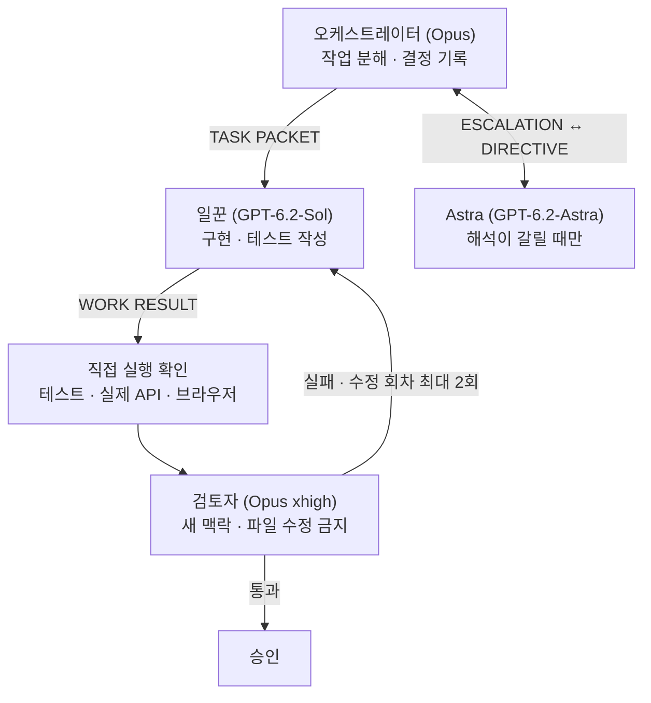

# astra-led-pipeline: 멀티 모델 오케스트레이션

이 저장소의 앱은 한 모델이 처음부터 끝까지 짠 코드가 아닙니다. 직접 설계한 Claude Code 스킬 `astra-led-pipeline`으로 역할을 나눈 여러 모델이 만들었습니다. 이 폴더에는 그 스킬의 원본(`skill/`)과 실제로 운영해 보며 바뀐 점을 정리했습니다.

## 역할

| 역할 | 모델 · 추론 강도 | 실행 방식 | 하는 일 | 하지 않는 일 |
|---|---|---|---|---|
| 오케스트레이터 | Claude Opus 5.5 · high | 사용자의 Claude Code 세션 | 작업 분해, 지시서(TASK PACKET) 작성, 결정 기록, 직접 실행 확인 | 코드 직접 구현, 자기 계획 검토 |
| 일꾼 | GPT-6.2-Sol · high | `codex exec` (workspace-write) | 구현과 테스트 작성. 파일을 고치는 유일한 역할 | 범위 밖 변경, 커밋 |
| 검토자 | Claude Opus 5.5 · xhigh | `claude -p` 새 세션 (읽기·실행만) | 직접 실행해 요구사항별 통과·실패 판정 | 파일 수정 |
| 에스컬레이션 | GPT-6.2-Astra · xhigh | `codex exec` (read-only) | 명세 해석이 갈리거나 반복 실패할 때 해결안(DIRECTIVE) 제시 | 코드 수정 |

검토자는 오케스트레이터와 같은 모델입니다. 그래서 독립성은 **맥락 분리**로 확보했습니다. 검토자에게는 변경 파일, 요구사항, 완료 기준, 검증 명령만 넘기고 "왜 그렇게 설계했는지"는 넘기지 않습니다.

## 흐름



우선순위는 다음 순서입니다(충돌 시 위가 이깁니다).

1. 사용자의 명시적 지시와 안전 규칙
2. Astra 지시
3. 오케스트레이터의 계획과 결정 기록
4. 검토자의 지적
5. 일꾼의 판단

Astra는 세 조건에서만 부릅니다.

- 같은 검증이 두 번 연속 실패할 때
- 일꾼과 검토자가 한 번 왕복한 뒤에도 의견이 갈릴 때
- 명세 해석이나 설계가 갈릴 때

## 실제 운영 기록 (2026-11-18, 하루)

| 항목 | 값 |
|---|---|
| 일꾼 호출 | 32회, 평균 약 9분(공개용 문서 재작성 1회 포함) |
| 검토자 호출 | 17회 완료: CLI 15회 + 한도에 막혔을 때 세션 내 서브에이전트 2회. 이와 별도로 CLI 2회는 사용 한도로 실패 |
| Astra 호출 | 1회(KOBIS 이용약관 대 로그 저장 요구, [사례 2](../process/case-studies.md#2-명세와-외부-api-약관의-충돌)) |
| 에이전트 실행 시간 합계 | 약 6.3시간(파이프라인 로그 기준, 서브에이전트 검토 제외) |
| 결과 | 단위 테스트 121개 통과, 합성 대표 시나리오 6/6, 실제 API 이벤트 샘플 6건 |

작업별 판정과 수정 내역은 [검토 기록](../process/review-log.md)에 있습니다.

## 운영하며 바꾼 점

스킬 문서대로만 돌리지는 않았습니다. 실제로 막힌 지점에 맞춰 다음처럼 조정했습니다.

- **"직접 실행 확인" 단계를 추가했습니다.** 일꾼의 샌드박스는 프로젝트 가상환경의 Python을 실행할 권한이 없었습니다. 그래서 모든 테스트는 오케스트레이터가 직접 돌리고, 지시서에는 "다른 런타임을 내려받지 말고 미실행으로 적을 것"을 넣었습니다. 첫 작업에서 일꾼이 임시 Python 런타임을 스스로 받아 쓴 일이 있었기 때문입니다.
- **실제 API 실행이 가장 많은 결함을 찾았습니다.** 대역(fake)으로 짠 단위 테스트는 처음부터 통과했습니다. 그러나 실제 키로 돌리자 LLM의 시각·날짜 오추출, 외부 API 간헐 지연, 이용약관 충돌이 드러났습니다. 사례는 [과정 기록](../process/case-studies.md)에 있습니다.
- **검토자 사용 한도에 대비했습니다.** xhigh 검토는 한 번에 수 분이 걸리고 사용량이 큽니다. 한도에 걸렸을 때는 같은 검토 요청서를 세션 내 읽기 전용 서브에이전트에 넘겼고, 독립성(새 맥락, 파일 수정 금지)은 그대로 유지했습니다.
- **왕복 상한을 지켰습니다.** 문서 검토가 두 번 실패한 뒤 세 번째 지적은 문구 수정뿐이었습니다. 이때 오케스트레이터가 반복하지 않고 멈춰서 사용자에게 처리 방식을 물었습니다.

## 실행 방법

```bash
# <skill_dir> = orchestration/skill
python <skill_dir>/scripts/pipeline.py ping   --repo <repo>                       # 세 CLI 연결 확인
python <skill_dir>/scripts/pipeline.py worker --repo <repo> --task-dir <dir>      # task_packet.md → work_result.md
python <skill_dir>/scripts/pipeline.py review --repo <repo> --task-dir <dir>      # review_request.md → review_result.md
python <skill_dir>/scripts/pipeline.py astra  --repo <repo> --task-dir <dir> --issue <id>   # issue당 2회 상한
```

`codex`와 `claude` CLI가 각자 로그인된 상태여야 합니다. 스크립트는 키를 다루지 않습니다. 호출마다 역할, 모델, 추론 강도, 소요 시간, 종료 코드가 `<repo>/.omc/pipeline/pipeline_log.jsonl`에 남습니다. 양식 5종(TASK PACKET, WORK RESULT, REVIEW RESULT, ESCALATION PACKET, ASTRA DIRECTIVE)은 [`skill/references/packets.md`](skill/references/packets.md)에 있고, 실제 사용 예시는 [`../process/examples/`](../process/examples/)에 있습니다.
